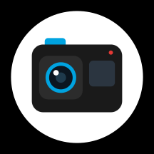
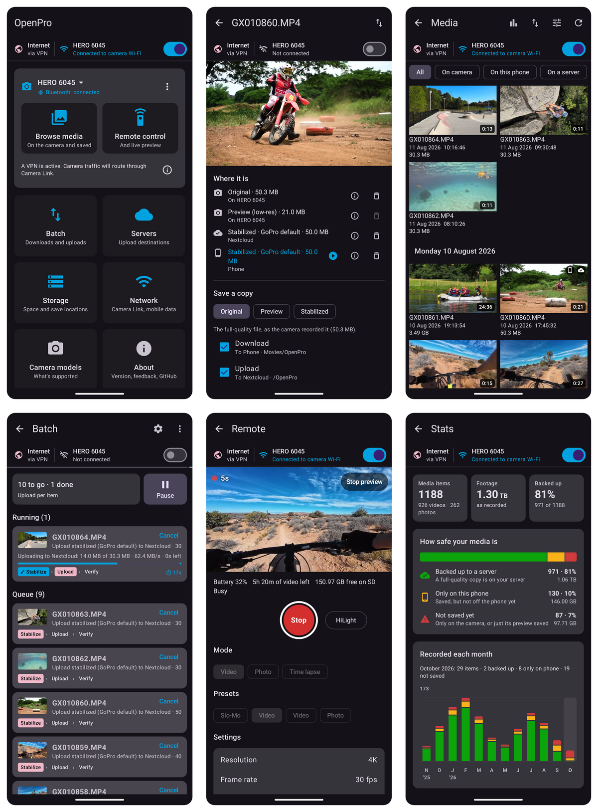

<p align="center">
  
</p>

<h1 align="center">OpenPro</h1>

<h3 align="center">An unofficial GoPro companion app for Android</h3>

<p align="center">
  
</p>

<p align="center"><i>Great hardware deserves great software. OpenPro is an open source companion app for GoPro cameras that does what you need, runs smoothly, and respects you as a user.</i></p>

OpenPro is an **alternative to the official GoPro Quik app** for getting media off your camera, stabilizing it, and controlling the camera. It leaves out video editing, and everything that gets in your way.

- 🪶 **Low storage footprint.** Previews stream straight from the camera, and only thumbnails are kept. Download just the clips you want, one at a time or in bulk.
- 💾 **Save to external storage.** Send downloads to an SD card, a USB drive, or any folder you pick, not just internal storage.
- ☁️ **Upload to your own server.** Nextcloud or any WebDAV server: no vendor lock-in, no subscription.
- 🎥 **GoPro's own stabilization.** OpenPro supports use of the same stabilization engine as the one found in the Quik app, run locally on your device, so your clips get all the same stabilization options that are available in Quik.*
- 🎮 **Remote control and live preview.** Start and stop recording, tag HiLights, switch presets, change settings, and watch what the camera sees.

\*The stabilization engine is GoPro's code, so it isn't included with OpenPro. The app's onboarding will take you through the steps to [add it yourself](#add-stabilization) from a copy of Quik.

## Contents

- [Contents](#contents)
- [Features](#features)
- [Supported cameras](#supported-cameras)
- [Build](#build)
  - [1. Build and install](#1-build-and-install)
    - [Set up your computer (once)](#set-up-your-computer-once)
    - [Then install OpenPro: pick one](#then-install-openpro-pick-one)
  - [2. Camera Link (optional)](#2-camera-link-optional)
- [Usage](#usage)
  - [Add stabilization](#add-stabilization)
  - [Connect a camera](#connect-a-camera)
  - [Browse and save](#browse-and-save)
  - [Storage](#storage)
  - [Adding your own server](#adding-your-own-server)
  - [Camera Link (VPN users only)](#camera-link-vpn-users-only)
- [About the app](#about-the-app)
- [Contribution \& Development](#contribution--development)
- [License](#license)

## Features

|Feature|Quik|OpenPro|Notes|
|---|:---:|:---:|---|
|Media browsing and download|✅|✅|Our app has a low storage footprint, offering previews streamed directly from the camera. Downloads are stored only once, and working files are deleted when they’re no longer needed.|
|Download to SD card or external storage|❌|✅|Internal storage, an SD card, or any folder you pick. Quik saves to internal storage only.|
|Upload to your own server|❌|✅|Nextcloud or any WebDAV server. Quik's only built-in upload is GoPro's cloud, which needs a paid subscription.|
|Batch download and upload|✅|✅|Queue your downloads and uploads and let the batch processor do the work. Thanks to smart Wi-Fi switching, your phone joins and leaves the camera’s Wi-Fi as each step requires. Jobs pick up where they left off if anything gets interrupted, so you can just set it and forget it!|
|Video stabilization|✅|✅|GoPro's own engine, taken from Quik. [Add it yourself](#add-stabilization) on your phone: it isn't included.|
|Remote control|✅|✅|Start and stop recording, HiLight tags, switch modes and presets, change settings, sync the clock, put the camera to sleep.|
|Live preview|✅|✅||
|Video editor|✅|❌|OpenPro focuses on managing your media and controlling your camera. Use your favorite editor for the rest.|
|Auto highlight videos|✅|❌|Not something we consider essential.|
|Camera firmware updates|✅|❌|Use Quik, or update from an SD card as GoPro describes.|
|GoPro model support|✅|⚠️|HERO9 Black and newer, and MAX2. See [Supported cameras](#supported-cameras).|
|Auto upload|✅|❌|The "Auto Upload" feature is likely tied to GoPro's servers at the firmware level.|
|Camera on the Home Network (COHN)|✅|❌|We would love to support this in future, but lack a test device with this feature.|
|Open source|❌|✅||

## Supported cameras

OpenPro is built and tested on the HERO (2024). Every camera on GoPro's Open GoPro list uses the same Bluetooth protocol, camera Wi-Fi and media commands, so those are supported too, but they haven't been tried with OpenPro yet. What stabilization a clip can get depends on the camera.

|Camera|Released|OpenPro|Tested|Stabilization|
|---|:---:|:---:|:---:|---|
|HERO (2024)|2024|✅|✅|All kinds. "GoPro default" is what Quik applies.|
|LIT HERO|2025|✅|Not yet|Same as HERO (2024).|
|MISSION 1 PRO, MISSION 1|2026|✅|Not yet|Whatever the engine allows for each clip.|
|MAX2|2025|✅|Not yet|360 clips: GoPro default, "Stabilize 360, level horizon" or "Stabilize 360, world lock", saved as 360 video (equirectangular).|
|HERO13 Black|2024|✅|Not yet|Whatever the engine allows, usually horizon leveling (these cameras stabilize as they record). Not with the Anamorphic Lens Mod.|
|HERO12 Black|2023|✅|Not yet|Same as HERO13 Black.|
|HERO11 Black, HERO11 Black Mini|2022|✅|Not yet|Same as HERO13 Black.|
|HERO10 Black|2021|✅|Not yet|Same as HERO13 Black.|
|HERO9 Black|2020|✅|Not yet|Same as HERO13 Black. Needs camera firmware 1.70 or later.|
|MISSION 1 PRO ILS|2026|❌|–|Quik reports it can't be stabilized.|
|HERO8 Black, MAX|2019|❌|–|–|
|HERO7 Black, HERO7 Silver, HERO7 White, HERO (2018)|2018|❌|–|–|
|HERO6 Black, Fusion|2017|❌|–|–|
|HERO5 Black, HERO5 Session|2016|❌|–|–|
|HERO4 Black, HERO4 Silver, HERO4 Session, HERO (2014), HERO+, HERO+ LCD|2014–2015|❌|–|–|
|HERO3+, HERO3, HERO2|2011–2013|❌|–|–|

## Build

Ready-made APKs of OpenPro and Camera Link are under [Releases](https://github.com/jumbo1631/openpro/releases).

**What you need**

- **A computer** (Windows, macOS or Linux) set up for Android development: see [step 1](#1-build-and-install).
- **An Android phone** running Android 13 or later with a 64-bit (arm64) processor, which is most phones from the last few years.

**Get the code:** on this page, click the green **Code** button › **Download ZIP** and unzip it, or run `git clone https://github.com/jumbo1631/openpro.git`. "This folder" below means that folder: the one with `settings.gradle.kts` in it.

### 1. Build and install

#### Set up your computer (once)

The build needs the Android SDK and Java 17. The easiest way to get both:

1. Install **[Android Studio](https://developer.android.com/studio)** ([installation guide](https://developer.android.com/studio/install)).
2. Open it, choose **Open**, and pick this folder (the one with `settings.gradle.kts` in it).
3. Wait for it to finish setting up (the progress bar at the bottom). It downloads the SDK, Java 17 and everything else the build needs.

<details>
<summary>Without Android Studio (command line only)</summary>

1. Install **JDK 17** (a newer JDK on its own won't do).
2. Download the [command-line tools](https://developer.android.com/studio#command-line-tools-only) and accept the SDK licences once: `sdkmanager --licenses` ([sdkmanager guide](https://developer.android.com/tools/sdkmanager)).
3. Tell the build where the SDK is: set `ANDROID_HOME`, or create a file called `local.properties` in this folder containing `sdk.dir=/path/to/your/sdk`.

</details>

Run the commands below in a terminal in this folder (Android Studio has one: **View › Tool Windows › Terminal**). On Windows, type `gradlew` instead of `./gradlew`.

#### Then install OpenPro: pick one

**Option A: over a USB cable**

1. On the phone, turn on **Developer options** and **USB debugging** ([how](https://developer.android.com/studio/debug/dev-options)).
2. Plug the phone into the computer, and tap **Allow** when the phone asks "Allow USB debugging?".
3. Run:

   ```bash
   ./gradlew :app:installDebug
   ```

   OpenPro appears in your app drawer.

**Option B: copy the APK to the phone (no debugging needed)**

1. Run:

   ```bash
   ./gradlew :app:assembleDebug
   ```

2. Copy `app/build/outputs/apk/debug/app-debug.apk` to your phone (USB cable, cloud drive, email to yourself, anything).
3. On the phone, open the file and tap **Install**. If Android says installing from that app isn't allowed, tap **Settings**, allow it, and go back.

### 2. Camera Link (optional)

Only if you need it: see [Camera Link](#camera-link-vpn-users-only). Build it on the same computer as OpenPro (both must be signed with the same key) and install it the same way as step 1:

- **Option A:** `./gradlew :link:installDebug`
- **Option B:** `./gradlew :link:assembleDebug`, then copy and open `link/build/outputs/apk/debug/link-debug.apk`

## Usage

### Add stabilization

OpenPro works without it, but can't stabilize until you add GoPro's engine from the GoPro Quik app. Currently, it has to be **Quik 13.43** exactly (latest version at time of writing). OpenPro offers this when it first opens (later, tap **About** -> **Add stabilization**). Then pick one of:

- **Use GoPro Quik on this phone**, if Quik 13.43 is installed.
- **Download from APKMirror**: opens [Quik 13.43 on APKMirror](https://www.apkmirror.com/apk/gopro-rm/gopro-formerly-capture-featuring-quikstories/gopro-quik-video-editor-13-43-release/gopro-quik-video-editor-13-43-android-apk-download/) inside OpenPro. Tap **Download APK Bundle** (about 200 MB) and OpenPro does the rest.
- **Pick the file**: an `.apkm`, `.xapk` or `.apks` bundle, or a single APK, of Quik 13.43.

OpenPro copies the engine into its own storage, so you can delete the download or uninstall Quik afterwards.

### Connect a camera

1. On the camera: Preferences › Wireless Connections › Connect Device.
2. In OpenPro: *Add device*, pick the camera, accept the pairing prompt.

To switch cameras, tap the camera's name on the home screen.

### Browse and save

- **Browse media** joins the camera's Wi-Fi. Without the camera, you still see its last listing and everything you've saved.
- **Tap a clip** to stream its preview and see where its copies are.
- **Download** or **Upload** the original, the low-res preview, or a stabilized version. Select several clips to do them all at once.
- **Batch** runs the queue, switches Wi-Fi as needed, and resumes after interruptions.

### Storage

- Downloads go to the phone (`Movies/OpenPro`, photos in `Pictures/OpenPro`), an SD card, or any folder you pick.
- Files are named by recording time (`2026-08-24_14-23-44_GX010849.MP4`), since GoPro reuses file names.

### Adding your own server

|Server|Sign in|Interrupted upload|
|---|---|---|
|Nextcloud|Nextcloud app, browser, or app password|Resumes|
|Any WebDAV (ownCloud, NAS, `rclone serve webdav`, …)|User name and password|Restarts that file|

- HTTPS (self-signed certificates can be trusted after checking) or plain HTTP.
- Uploads are sorted into a folder per month, and nothing is uploaded twice.
- Mobile data and automatic Wi-Fi switching are set on the *Network* page.

### Camera Link (VPN users only)

Android sends all of an app's traffic through an active VPN, including traffic meant for the camera's Wi-Fi, so the camera can't be reached. Usually the fix is simple: turn the VPN off, or exclude OpenPro from it.

You need Camera Link only if your upload server is reachable **only through your VPN**, so OpenPro has to stay inside it. Install Camera Link alongside OpenPro and exclude **Camera Link** (not OpenPro) from the VPN. OpenPro always tries the camera directly first, and goes through Camera Link only when the VPN blocks it.

**TLDR:** You only need the Camera Link app installed alongside OpenPro if **_all_** the following apply:
  
  1. You connect to the internet over a VPN
  2. Your upload server is only reachable over a VPN
  3. You are able to exclude specific apps from your VPN (in which case **exclude** Camera Link)

If 3 is not true, then you will simply have to manually disable your VPN when connected to camera Wi-Fi, and re-enable it for uploads.

## About the app

I made this app due to long-standing disatisfaction with the Quik app. My experience with Quik was so bad that it made me not want to use my HERO or any other GoPro product, which is a shame because I like the tech itself. 

It was always a nightmare to get the media off the camera. I had constant storage issues, and the app crashed constantly with no transparency as to why, and no error reporting. Camera connection would drop frequently, requiring a camera restart, presumably due to overloading and crashing the camera's own web server. On top of all of this, the app pushes its paid subscription service on every screen. Overall, Quik is a very poor companion app in its current form. I hope that you try OpenPro yourself if only to appreciate the difference in quality, stability and user-friendliness.

This app was made entirely using AI (Opus 5.5), the bulk of which was done in just two days. I did not write a single line of code. However, I spent a lot of time testing and refining the design of the app, constantly iterating to resolve bugs and improve usability (and add awesome features!). 

I am very pleased with the current state of the app and hope to support as many devices as possible.

## Contribution & Development

I welcome all issues, bug reports, feature requests, PRs, and general feedback. I only own one GoPro camera right now - the HERO (2024) - which has been the only test device so far, so I would love to hear about others' experiences with the app using other cameras.

While I welcome all contributions - including those done by AI - please keep PRs as minimal as they need to be, and please test your changes and cite your test device model.

**Code layout** (the app's code is in `app/src/main/java/com/openpro/`):

- `camera/`: Bluetooth (`ble/`), Wi-Fi join (`wifi/`), the camera's HTTP API (`http/`), the Camera Link client (`link/`), sessions, and the model catalog
- `media/`: media listings, thumbnails, clip lengths and file names
- `batch/`: the durable job queue (Room), its runner and WorkManager worker
- `storage/`: downloads, storage volumes, gallery publishing
- `copies/`: the index of every copy saved or uploaded
- `server/`: Nextcloud and WebDAV clients and sign-in
- `quik/`: GoPro engine integration: adding it from a Quik file, and running it in a separate `:quik` process
- `net/`: network monitor (camera Wi-Fi, internet, switching)
- `ui/`: Compose screens

Elsewhere in the repo:

- `app/src/main/java/com/gopro/quikengine/`: the JNI shim the GoPro engine binds to (keep its names unchanged)
- `shared/`: camera Wi-Fi join and the Camera Link protocol, compiled into both apps
- `link/`: Camera Link

## License

OpenPro and Camera Link are free software, released under the [GNU General Public License v3.0](LICENSE): you can use, study, share and change them, and anything you distribute that's built from them must be under the same license, with its source available.

GoPro's stabilization engine is not part of OpenPro and isn't covered by this license: it's GoPro's own code, which each user adds from their own copy of GoPro Quik. OpenPro is not made or endorsed by GoPro.
